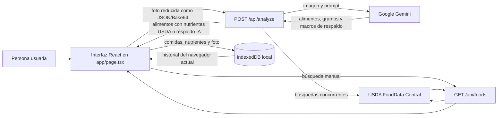

# Arquitectura de MacroTrack

## Resumen

MacroTrack es una aplicación web de una sola página construida con Next.js. Permite analizar una foto de comida con Gemini, completar los datos nutricionales con USDA FoodData Central y guardar un diario local en el navegador. No hay cuentas ni un servicio propio de persistencia: las rutas del servidor actúan como intermediarias para las API externas y los datos del diario permanecen en IndexedDB del dispositivo.

## Tecnologías y sistemas

- **Next.js 15 y React 19**: interfaz, enrutamiento y rutas API en el mismo proyecto. TypeScript está configurado en modo estricto.
- **Cliente web (`app/page.tsx`)**: componente React marcado como `use client`. Gestiona la foto, los alimentos detectados/editables, las búsquedas, el resumen de macros y el diario.
- **Rutas de servidor de Next.js**:
  - `POST /api/analyze`: valida el cuerpo de la solicitud, solicita la identificación de alimentos a Gemini, busca cada resultado en USDA y devuelve una lista enriquecida.
  - `GET /api/foods?q=...`: busca alimentos en USDA para añadir o corregir un elemento manualmente.
- **Google Gemini**: visión y estimación de alimentos, porciones y macros de respaldo. La clave se lee desde `GEMINI_API_KEY` en el servidor; el navegador no la recibe.
- **USDA FoodData Central**: fuente principal de nutrientes y buscador manual. Se usa `USDA_API_KEY` en el servidor, con `DEMO_KEY` como alternativa para pruebas.
- **IndexedDB mediante `idb` (`lib/db.ts`)**: guarda comidas y fotos localmente en la base `macrotrack`, almacén `meals`, versión 1.
- **Modelo de dominio (`lib/types.ts`)**: define comidas, alimentos y macros; calcula nutrientes según la cantidad en gramos.
- **Estado de red (`lib/network.ts`)**: traduce fallos de red de `fetch` (`TypeError`) a un mensaje de "Sin conexión" y escucha los eventos `online`/`offline` para mostrar un aviso en la interfaz.
- **PWA**: `app/manifest.ts` e iconos en `public/icons/` y `app/apple-icon.png`. `public/sw.js` es un service worker en JS plano que no pasa por el build. Se registra solo en producción desde `app/service-worker-register.tsx`, montado en `app/layout.tsx`. Las navegaciones van primero a la red. Sin red, sirve `/` desde caché y, si no existe, `public/offline.html`. Los recursos de `/_next/static/` se sirven primero desde caché. `/api/` nunca se cachea.

## Flujo de datos
## Se explica al final



### Análisis de una foto

1. El navegador acepta JPG, PNG o WebP de hasta 12 MB. La imagen se dibuja en un canvas, se limita a 1600 px por lado y se codifica como JPEG con calidad 0,82.
2. El cliente envía el JPEG como Base64 a `POST /api/analyze`. La ruta vuelve a validar el tipo MIME, la codificación y un máximo de 8 MB para los datos recibidos.
3. Gemini devuelve JSON estructurado por alimento: nombre visible, término de búsqueda en USDA, gramos estimados y macros por 100 g para usar solo como respaldo.
4. El servidor consulta USDA para cada alimento, con un máximo de cuatro búsquedas concurrentes. Si no hay coincidencia o la búsqueda falla, el alimento queda marcado como estimación de IA.
5. El usuario puede corregir alimentos, ajustar gramos y guardar la comida. Los macros se escalan linealmente desde los valores por 100 g.

### Búsqueda, cálculo y diario

- La búsqueda manual utiliza `GET /api/foods` y presenta los resultados USDA para añadir un alimento o reemplazar la coincidencia de uno detectado.
- `foodMacros` multiplica cada nutriente por `gramos / 100`; `mealMacros` suma los resultados de los alimentos de la comida.
- Al guardar, se persisten en IndexedDB el identificador, la fecha ISO, alimentos, nutrientes y, si existe, la foto. El historial se ordena por fecha y la interfaz muestra las ocho comidas más recientes.
- El borrado elimina la comida de IndexedDB en ese navegador. No existe sincronización entre dispositivos.

## Decisiones de diseño observadas

- **API keys exclusivamente del lado servidor**: las llamadas a Gemini y USDA pasan por rutas de Next.js y las credenciales se leen desde variables de entorno, en vez de exponerse con variables `NEXT_PUBLIC_*`.
- **USDA como fuente nutricional principal**: la visión identifica alimentos y estima porciones; los nutrientes se buscan en la base de datos nutricional cuando es posible. Los respaldos de IA se etiquetan como aproximados.
- **Revisión humana antes de guardar**: los alimentos y las porciones se pueden editar, eliminar o corregir para reducir el impacto de errores de reconocimiento.
- **Persistencia local y sin cuentas**: IndexedDB evita necesitar una base de datos o backend de usuarios para el MVP y mantiene el diario en el navegador/dispositivo actual.
- **Restricciones y respuestas de error explícitas**: se limitan tamaño y formatos de imagen, cantidad de resultados, longitudes de consultas y rangos numéricos. Las rutas distinguen errores de configuración, validación, límites de API y fallos externos.
- **Ejecución Node.js en las rutas API**: ambas declaran `runtime = 'nodejs'`; la interfaz y el servidor comparten el proyecto Next.js.

## Límites y aspectos pendientes

- **Persistencia y privacidad**: el diario no tiene copia de seguridad ni sincronización y se puede perder al borrar los datos del navegador. La foto se guarda localmente si la persona guarda la comida, pero al analizarla se envía a Gemini.
- **Sin autenticación ni límites por usuario**: las rutas no requieren cuenta ni implementan rate limiting propio. Si se despliega públicamente, conviene proteger el uso para evitar consumo no autorizado de las cuotas de Gemini y USDA.
- **Dependencia de servicios externos**: el análisis requiere Gemini; búsquedas y enriquecimiento dependen de USDA, conexión, cuotas y disponibilidad de esos servicios. `DEMO_KEY` tiene límites bajos.
- **Calidad nutricional aproximada**: estimar alimentos, cantidades y preparación desde una foto tiene incertidumbre. La coincidencia genérica de USDA puede no representar marca, receta o método de cocción exactos; los macros se escalan linealmente por peso.
- **Robustez del almacenamiento**: la base de IndexedDB está en versión 1 y no hay flujo de migración de datos ni exportación/importación documentados.
- **Operación y observabilidad**: hay mensajes de error y registros básicos en el servidor, pero no se observan métricas, seguimiento de errores, alertas ni una estrategia de caché para USDA.
- **Despliegue**: el repositorio contiene scripts de desarrollo, lint, typecheck y build, pero no se observa configuración de CI/CD, hosting o gestión de secretos para producción. En producción se deben configurar `GEMINI_API_KEY` y, de ser necesario, `GEMINI_MODEL` y `USDA_API_KEY` en el entorno del servidor.
- **Pruebas automatizadas**: Vitest en entorno `node` (sin jsdom), con tests `*.test.ts` junto al código. Cubren el modelo de macros, la ruta `/api/foods`, los mensajes de red, el registro del service worker y `public/sw.js`. `app/sw.test.ts` ejecuta el service worker con `node:vm` y simula `caches` y `fetch`. No hay tests de `/api/analyze`, `lib/db.ts` ni de la interfaz.
- **Offline limitado**: sin conexión solo se abre la interfaz cacheada y se consulta el historial. Analizar fotos y buscar alimentos necesitan Internet, y no hay entrada manual de alimentos para crear comidas desde cero sin red.

## Configuración y comandos

Las variables esperadas están descritas en `.env.example`; las claves locales se guardan en `.env.local`, excluido por Git.

```bash
npm install
npm run dev
npm test
npm run lint
npm run typecheck
npm run build
```

La aplicación se sirve localmente en `http://localhost:3000` durante el desarrollo.


## Explicación Flujo de datos (From claude.ai)
Aquí tienes el diagrama; abajo te explico el recorrido paso a paso.

Las flechas con dos puntas indican que los datos van y vuelven (petición y respuesta). Se lee así:

1. **Análisis de una foto:** la persona sube una foto en la interfaz React, que la reduce y la envía como Base64 a `POST /api/analyze`. Esa ruta se la pasa a Gemini junto con un prompt. Gemini devuelve los alimentos detectados, los gramos estimados y unos macros de respaldo.
2. **Datos oficiales:** `/api/analyze` consulta USDA FoodData Central con varias búsquedas a la vez, una por alimento. Cada alimento vuelve a la interfaz con los nutrientes de USDA si existen y, si no, con la estimación de la IA.
3. **Búsqueda manual:** si quieres corregir o añadir un alimento a mano, la interfaz llama a `GET /api/foods`, que busca directamente en USDA.
4. **Persistencia:** las comidas, los nutrientes y la foto se guardan en IndexedDB, dentro del navegador. Por eso el historial solo se ve en el navegador y dispositivo donde se hizo, y no se sincroniza con ningún servidor.

Puedes hacer clic en cualquier caja para profundizar en esa parte.
